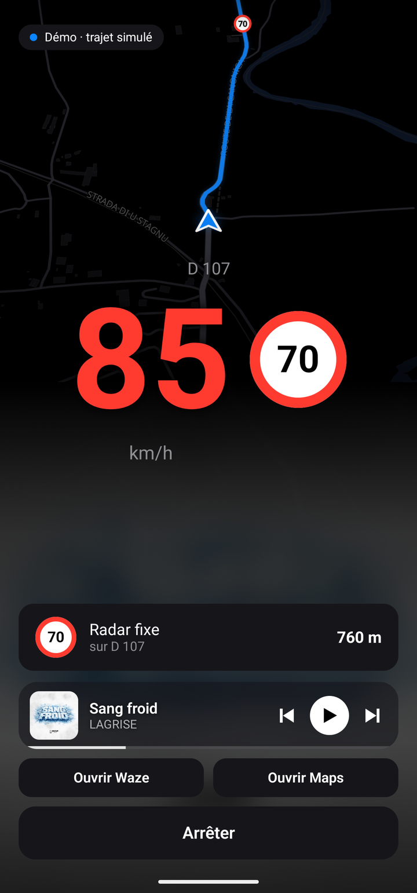
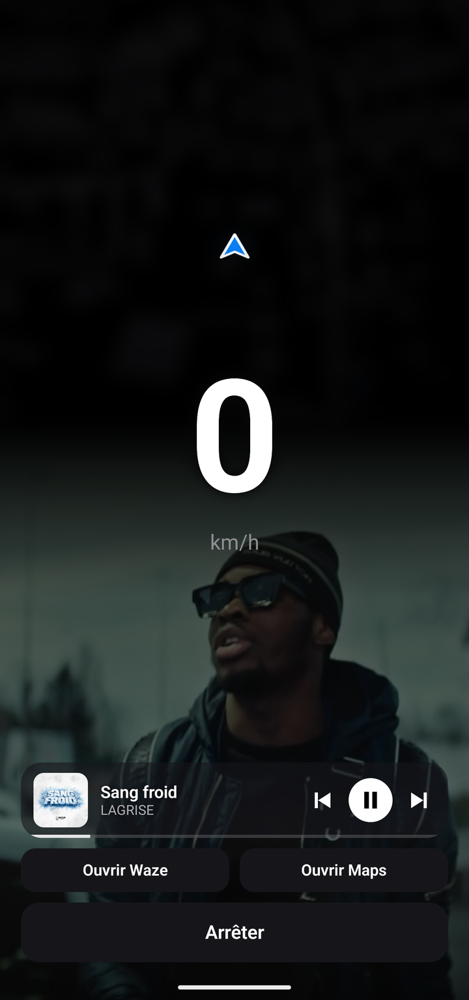
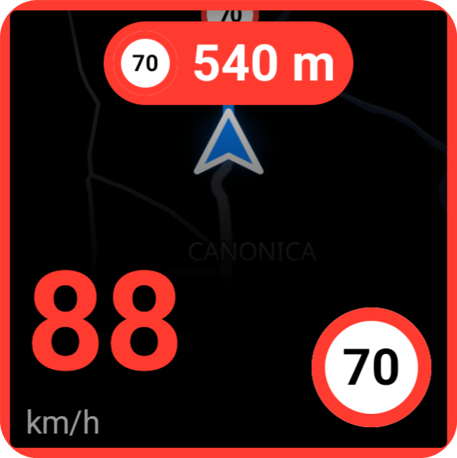

# Zenith

Alertes radars gratuites pour Android et iPhone, simples et sans compte. Zenith tourne en fond, derrière Waze ou Google Maps, et te prévient par la voix et par des bips, même écran éteint.

  
  
  

  <a href="https://github.com/LightZirconite/zenith/releases/latest/download/zenith.apk"><b>⬇ Android : télécharger l'APK</b></a>
  &nbsp;·&nbsp;
  <a href="https://github.com/LightZirconite/zenith/releases/download/ios/sidestore.json"><b>iPhone : source SideStore</b></a>

## Installation sur Android

Zenith ne vient pas du Play Store : Play Protect peut bloquer l'installation, parce que l'app demande des autorisations sensibles (accès aux notifications pour la musique, position en arrière-plan, installation des mises à jour).

1. Ouvre le Play Store → ta photo de profil → **Play Protect** → ⚙ → désactive **Analyser les applications avec Play Protect**.
2. Télécharge et installe l'APK.
3. Réactive Play Protect.

Ensuite, Zenith se met à jour tout seul.

## Installation sur iPhone (SideStore)

Zenith ne vient pas de l'App Store : il s'installe avec [SideStore](https://sidestore.io), gratuit, avec ton identifiant Apple (sans compte développeur payant). Il faut iOS 26 ou plus récent.

1. Installe SideStore en suivant [son guide](https://docs.sidestore.io) (une seule fois, avec un ordinateur).
2. Dans SideStore → **Sources** → **+**, ajoute :
   `https://github.com/LightZirconite/zenith/releases/download/ios/sidestore.json`
3. Ouvre la source et installe **Zenith**. SideStore demande s'il garde l'extension : **Keep** garde l'Activité en direct (écran verrouillé, Dynamic Island, bouton « Arrêter ») mais prend un App ID de plus ; **Remove** économise cet App ID, tout le reste marche (petite fenêtre comprise).
4. Au premier lancement, accepte les autorisations une par une (position « Toujours », notifications, mouvements, Apple Music).

**Quota du compte gratuit** : Apple limite un identifiant gratuit à 10 App ID par 7 jours et 3 apps actives (SideStore compris). Zenith prend 1 App ID (2 avec l'extension) **une seule fois** : une mise à jour réutilise le même App ID (vérifié dans le code de SideStore), tu peux donc mettre à jour aussi souvent que tu veux.

**Mises à jour** : chaque nouvelle version arrive dans la source. SideStore te prévient et Zenith affiche « Mise à jour disponible » : un appui sur **Installer** l'envoie à SideStore. iOS n'autorise pas une app à s'installer seule, il reste donc une confirmation dans SideStore. Ouvre SideStore de temps en temps : il renouvelle la signature (un identifiant Apple gratuit signe pour 7 jours).

**Spotify sur iPhone** : iOS ne laisse pas Zenith voir ce que joue Spotify. Il faut connecter ton compte dans les réglages de Zenith (**Se connecter à Spotify**). Une seule app Spotify sert à tout le monde, celle de l'auteur, dont l'identifiant est mis par la CI dans chaque version : personne d'autre n'a rien à créer. Mais Spotify limite une app en mode développement à 5 comptes, que l'auteur ajoute à la main (l'ouverture à tous est réservée aux entreprises). Pour l'auteur du dépôt : crée une app sur [developer.spotify.com](https://developer.spotify.com/dashboard) (coche « Web API », adresse de retour `zenith://spotify-callback`, puis Settings → User Management : ton nom et ton e-mail Spotify, 5 comptes au plus ; Spotify exige que le propriétaire de l'app ait Premium), puis mets son *Client ID* dans la variable `SPOTIFY_CLIENT_ID` du dépôt (Settings → Secrets and variables → Actions → Variables). La version suivante le contient.

**Démarrage à la connexion de la voiture** : iOS ne prévient pas les apps quand la voiture se connecte, mais l'app Raccourcis le fait. Une fois par voiture : Raccourcis → **Automatisation** → **+** → **CarPlay** (ou **Bluetooth** → ta voiture) → **Est connecté** → action Zenith **Voiture connectée** → **Exécuter immédiatement**. Puis la même chose avec **Est déconnecté** → **Voiture déconnectée** (la conduite s'arrête si c'est la voiture qui l'a démarrée). Siri comprend aussi « Démarre Zenith » et « Arrête Zenith ».

### Ce qui change sur iPhone

| | Android | iPhone |
|---|---|---|
| Petite fenêtre au-dessus de Waze | fenêtre libre, carte complète | fenêtre image dans l'image, carte des routes autour de toi dessinée par Zenith (mêmes infos) |
| Écran verrouillé | notification avec la vitesse et « Arrêter » | Activité en direct et Dynamic Island, avec « Arrêter » |
| Musique | tous les lecteurs (Spotify, YouTube, Deezer…) | Spotify (compte connecté) et Apple Music seulement |
| Contrôle de Spotify | toujours | précédent / pause / suivant avec Spotify Premium (règle de Spotify) |
| Démarrage auto | en roulant ou à la connexion de la voiture | en roulant, et à la connexion de la voiture par une automatisation Raccourcis (voir plus bas) |
| Mises à jour | installées seules | proposées par SideStore, une confirmation |
| Volume monté pendant la conduite | oui | oui (glissière de volume du système) |

## Zenith et Waze

Waze est fait pour te guider ; Zenith est fait pour te prévenir. Les deux tournent ensemble : Waze devant, Zenith en fond.

- **Les radars d'abord** : Zenith rassemble chaque jour toutes les sources gratuites (liste officielle, carte de la Sécurité routière, OpenStreetMap, Lufop), les fusionne et retire les doublons. Pas besoin d'attendre qu'un autre conducteur signale un radar.
- **Seulement ta route** : un radar sur une route parallèle ou une sortie que tu ne prends pas ne sonne pas. Garé ou à la maison, rien ne sonne.
- **Des alertes faites pour ça** : voix courte, bips qui s'accélèrent si tu es trop vite, « Ralentis » quand il est temps de freiner, moyenne en direct sur les tronçons.
- **Libre et sans rien en échange** : code ouvert, aucune publicité, aucun compte, ta position ne quitte jamais le téléphone.
- **Une app soignée** : décollage dans les étoiles, verre, transitions et sons pensés pour la route.

## Fonctionnalités

- Ta vitesse et la limitation de la route, en grand
- Radars fixes, feux rouges, tronçons et itinéraires de contrôle, uniquement sur ta route
- Alertes vocales en français et bips qui s'accélèrent si tu roules trop vite ; la musique baisse en douceur, sans s'arrêter
- Moyenne en direct sur les radars tronçons
- Petite carte pour te situer, et un décollage dans les étoiles vers la Terre le temps de trouver le GPS
- Petite fenêtre par-dessus Waze ou Maps ; sur iPhone aussi l'Activité en direct (écran verrouillé, Dynamic Island)
- Musique à l'écran (Android : Spotify, YouTube, Deezer… ; iPhone : Spotify et Apple Music), avec le Canvas Spotify qui prend plus de place à l'arrêt ; glisse pour changer de titre
- Démarre seul quand tu roules (et sur Android quand l'une de tes voitures se connecte), s'arrête seul une fois garé
- Mode pluie automatique
- Mises à jour automatiques

## Autorisations (Android)

Au premier lancement, Zenith explique chaque autorisation et un seul bouton « Continuer » les ouvre une par une.

- **Position précise** : mesurer ta vitesse et savoir quels radars sont sur ta route. Ta position ne quitte jamais le téléphone. Choisis « Pendant l'utilisation de l'appli ».
- **Notifications** : Android exige une notification pour que Zenith reste actif en fond. Elle affiche ta vitesse et le prochain radar.
- **Installer des applis inconnues** : pour les mises à jour automatiques, l'app ne vient pas du Play Store. Active l'interrupteur puis reviens.
- **Batterie sans restriction** : pour qu'Android ne coupe pas les alertes pendant un long trajet. Accepte la fenêtre d'Android.
- **Activité physique et position « Toujours »** : pour démarrer seul quand tu roules. Autorise l'activité, puis choisis « Toujours autoriser » pour la position.
- **Accès aux notifications** : pour afficher et contrôler ta musique. Zenith n'y lit que le lecteur. Touche « Activer » ; si Android bloque, va dans Infos de l'appli → ⋮ → « Autoriser les paramètres restreints », puis « Activer » à nouveau.

## Autorisations (iPhone)

- **Position, puis « Toujours »** : vitesse, route suivie, radars ; « Toujours » garde les alertes écran éteint et permet le démarrage en roulant. Ta position ne quitte jamais le téléphone.
- **Notifications** : « Zenith est en route » quand la conduite démarre seule.
- **Mouvements et forme** : reconnaître que tu montes en voiture.
- **Apple Music** : afficher et piloter le titre en cours de l'app Musique.
